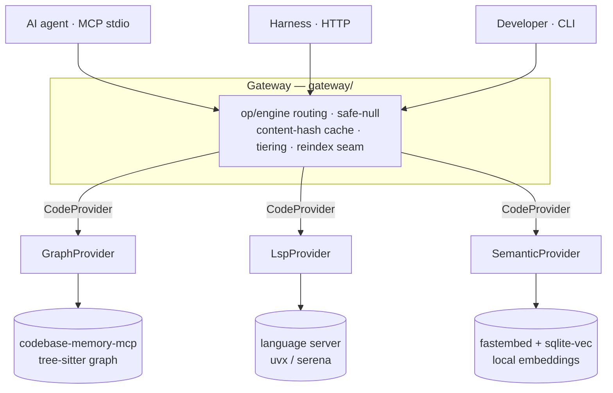
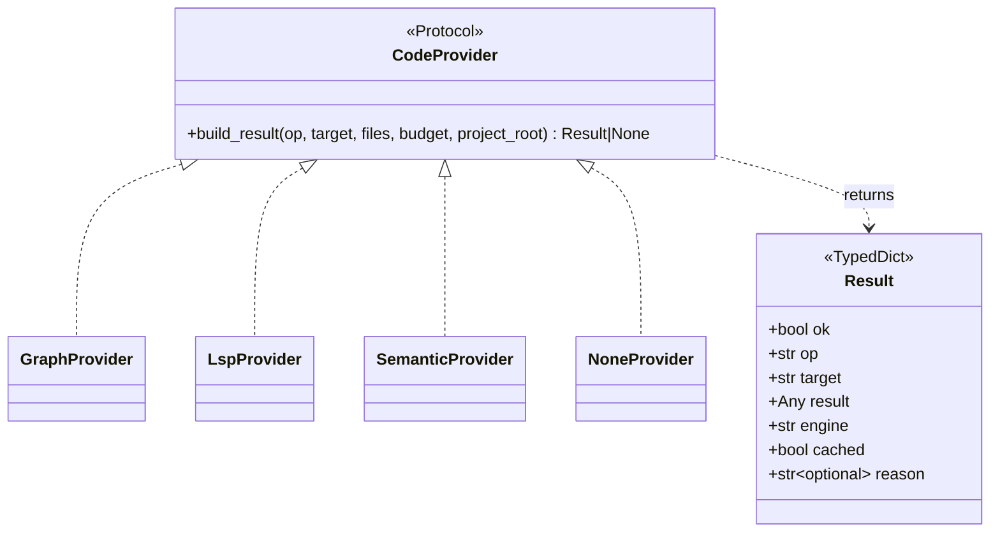
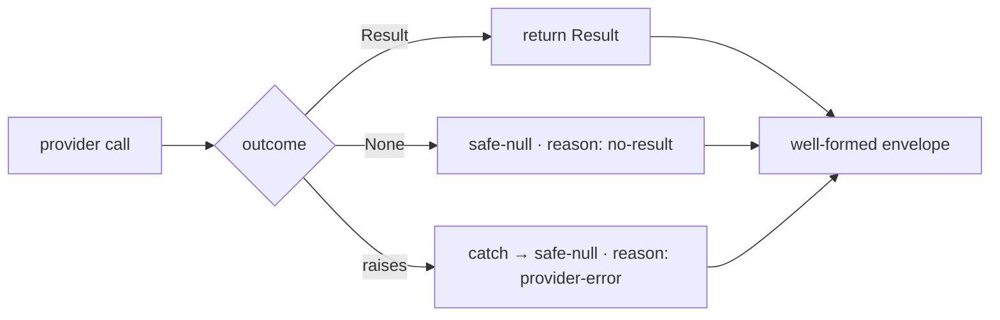

# Architecture

`codeintel` is a **layered, single-responsibility** system: three interchangeable engines sit
behind one protocol, one gateway unifies them, and three transports expose the gateway. Every
layer only ever *adds* information to a response — it can never break one (the [never-raise
contract](#safe-null-contract)).

## The big picture

```
                       ┌──────────────────────────────────┐
   agent   (MCP)  ────▶│  Gateway  (gateway/)              │
   harness (HTTP) ────▶│   • op → engine routing           │
   human   (CLI)  ────▶│   • safe-null contract            │
                       │   • content-hash cache            │
                       │   • auto-detect + reindex seam    │
                       │   • optional role/op tiering      │
                       └───────────────┬──────────────────┘
                                       │  CodeProvider protocol
                 ┌─────────────────────┼─────────────────────┐
                 ▼                     ▼                     ▼
          GraphProvider          LspProvider          SemanticProvider
          (breadth)              (precision/fresh)    (meaning)
                 │                     │                     │
        codebase-memory-mcp     language server        fastembed +
        (tree-sitter graph)     (uvx / serena)         sqlite-vec  (in-house)
```



## Layers

The package layout under `src/codeintel/` *is* the layering: six packages, top to bottom.

| # | Layer | Package | Holds |
|---|---|---|---|
| 1 | **CLI** | `cli/`, `__main__.py` | Argument parsing (`__main__.py`) and one module per subcommand, each exposing `run(args) -> int`. |
| 2 | **Transports** | `transports/` | `mcp.py` (MCP stdio server and its `code.*` tools), `http.py` (HTTP, loopback only), `metrics.py`. Accept a request, hand it to the gateway, return the envelope verbatim. |
| 3 | **Tools** | `setup/`, `c4/`, `mapping/` | Everything that is not a query: install, onboarding, `doctor`, `verify`, `reset`, the agent prompt (`setup/`); the `codeintel c4` model, layer inference and layer check (`c4/`); the `CODE_INTEL.md` mapper, graph export and HTML viewer (`mapping/`). |
| 4 | **Gateway** | `gateway/` | `gateway.py` routes by op/engine, fans out and merges, enforces the contract; `cache.py`, `policy.py` + `auth.py` (RBAC), `reindexer.py`; `factory.py` builds a gateway with whatever engines this machine can run, for every front door. |
| 5 | **Engines** | `engines/graph/`, `engines/lsp/`, `engines/semantic/`, `engines/none.py` | One package per engine, each with a `provider.py` adapter that **never raises**. The graph adapter composes `backend.py` (`BackendClient`, the subprocess transport), `resolution.py` (`ProjectResolver`), `render.py` (path/label + render helpers), `wire_text.py` (reads the `0.10.x` backend's text dialect back into the `0.9.x` shapes every renderer parses; see [graph.md](graph.md)) and the op modules. The semantic engine is fully in-house: `indexer.py`, `db.py`, `searcher.py`. |
| 6 | **Core** | `core/` | The `CodeProvider` protocol, the `Result` envelope and `safe_null_result` (`provider.py`), plus cross-cutting primitives every layer may use: `paths`, `config`, `redact`, `filelock`, `source_kind`, `containment`, `term`, `outcome`, … |

**The rule:** an import may point down the table or stay inside its own layer, never up. Engines
also never import each other: each is an independent adapter behind the protocol, which is what
keeps "swap a backend" true. Shared code moves down to `core/`.

The rule is enforced twice:

- `tests/test_architecture.py` reads every import from the AST (function-local ones included) and
  fails on an upward import or an engine-to-engine import. It needs no backend, so it runs on every
  CI leg. The single deliberate engine exception (`engines/graph/symbol_diff.py` reuses the semantic
  indexer's tree-sitter definition tables) is listed there with its reason.
- `.codeintel.toml` declares the same layers, and CI's `c4-validate` job runs
  `codeintel c4 . --check` on this repository: the product checking its own architecture from the
  live graph. See [c4.md](c4.md#checking-a-declared-layer-config-in-ci).

**Adding a module:** put it in the lowest layer whose code it needs. A new top-level module outside
these packages fails `test_every_module_belongs_to_a_layer`.

## The CodeProvider protocol

Every engine implements the same one-method interface, so engines are swappable and composable
(`both`/`all` just fan out and merge). This is the seam that lets a wrapped backend be replaced by
an in-house one later **without changing the public contract**.



`build_result` returns a `Result` on success or `None` when it has nothing — **never an
exception**. The gateway turns `None` into a safe-null envelope.

## Safe-null contract

Every response is the same shape, and `ok` is always `true` at the tool boundary:

```json
{ "ok": true, "op": "search", "target": "auth", "result": null,
  "engine": "semantic", "cached": false, "reason": "no-result" }
```

- `result: null` never means "crash" — it means *found nothing*, *engine not installed*, or
  *not indexed yet* (see `indexing-in-progress` below — that one is not "nothing found" either).
- `reason` distinguishes them: `no-result`, `engine-unavailable`, `project-not-indexed`,
  `not-in-graph` (the symbol is absent from the index — in practice, a stale index),
  `unsupported-op`, `root-not-allowed-for-role` (RBAC), `warming` (the LSP session is booting),
  `indexing-in-progress` (semantic engine, cold repo — see below).
- `hint` carries the command that resolves that `reason`, where one exists.
- `reindexing` marks an answer served while a reindex was in flight: it reflects the last
  *completed* index. Structural targets hash a symbol name rather than file bytes, so nothing else
  in the envelope could reveal it.
- `indexing-in-progress` means *not "nothing found"* — no semantic index existed for this project
  yet, and one has just started building in the background; retry shortly, or run
  `codeintel index <path>` to build it synchronously right now. This is transport-specific and one
  of the few user-visible differences between the one-shot CLI and the long-lived MCP/HTTP server:
  the CLI (`codeintel query`) has no other way to ever build a cold index and can afford to wait, so
  it still indexes **inline, synchronously**, with a live progress display, and never returns this
  reason. The persistent server would otherwise block a request thread for a multi-minute cold pass
  (plus a one-time embedding-model download) with nothing to show for it, so it returns this
  envelope immediately instead and finishes the pass off-thread — see
  [semantic.md](semantic.md#safe-null-reasons).
- The invariant is **tested by fault injection**, not just convention (`tests/test_never_raise.py`).



## Content-hash cache

`gateway/cache.py` keys results by `(op, target, engine, project_root)` plus a freshness generation. A
repeated query on an unchanged file is served from cache (`cached: true`); an edit changes the
content hash and forces a refresh. This keeps hot paths cheap without ever serving stale results
across an edit. Ops whose answer depends on live, unhashable state — the `changed` op reads the
uncommitted git worktree — bypass the cache entirely (`gateway._UNCACHED_OPS`), on both the
single-engine and fan-out paths, since the content-hash key can't see that state.

## Freshness / reindex seam

`gateway/reindexer.py` fires a **debounced, fire-and-forget** background reindex (semantic + graph) from a
query — it never blocks the response. Disabled with `CODEINTEL_REINDEX=off`. See
[query-flow.md](query-flow.md) for where it sits in the request path.

## Design principles

- **Never-raise everywhere** — a provider failure can only *subtract* an answer, never break a response.
- **Provider protocol** — engines are swappable; the public contract is independent of any backend.
- **Local-first & private** — no network egress in the default path; the semantic engine runs on a local model.
- **Single responsibility** — gateway / providers / index-store / transports / config are separate concerns, each a small file.

## Privacy & dependencies

codeintel is a **single local process** — no cloud service, no API keys, no telemetry, no per-query network. A source scan finds zero outbound HTTP clients or API-key usage in its own code; the HTTP transport binds to `127.0.0.1` only.

| Kind | What | Notes |
|---|---|---|
| Python libs (bundled) | `mcp`, `sqlite-vec`, `fastembed` | installed with the package; run locally |
| External backend — graph | `codebase-memory-mcp` (subprocess) | optional; auto-detected via `shutil.which` |
| External backend — lsp | `uvx` / `serena` (subprocess) | optional; auto-detected |
| External backend — semantic | *(none)* | fully in-house |

**Network:** the only egress is first-run downloads — `fastembed` fetches the `BAAI/bge-small-en-v1.5` model once, offline thereafter, and the optional backends install on first use if you opt in. It lands in `fastembed`'s own default cache, **not** `~/.cache`; [install.md](install.md#offline--air-gapped-install) owns that path and the `FASTEMBED_CACHE_PATH` override, because a location repeated in three files is a location that gets corrected in two. After setup, no code or data leaves the machine — which is what makes `both`/`all` fan-out safe to run on private repos.

## See also

- [query-flow.md](query-flow.md) — the request lifecycle, engine selection, fan-out, caching.
- [graph.md](graph.md) · [lsp.md](lsp.md) · [semantic.md](semantic.md) — per-engine references.
- [map-file.md](map-file.md) — the static `CODE_INTEL.md` orientation layer.
